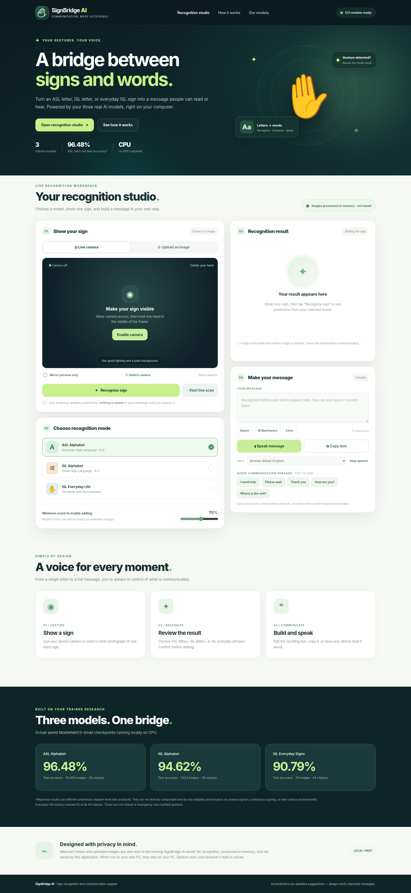

# SignBridge AI — Real Model-Powered Website

A ready-to-run, **local-first ASL / ISL sign recognition and communication website**, built using the exact `.pth` files from the supplied `SignBridge_Models-20261112T032612Z-1-001.zip` archive. No demo/random predictions and **no GPU is required**.



## What you can do

- **Live webcam:** show a sign in the center crop guide, capture it, or start repeatedly updating the recognition result.
- **Upload:** classify a JPG, PNG, WEBP or BMP sign photograph.
- **Three independently trained modes:** ASL A–Z, ISL A–Z, ISL Everyday Life (44 trained classes).
- **Review predictions:** see model score and top-three alternatives, set a minimum score threshold; nothing automatically enters the message.
- **Compose:** add letters or everyday phrase predictions, edit text manually, insert a space, backspace, clear, and copy.
- **Speak:** use your browser's English speech voices to read the composed text aloud; quick communication phrases also work without recognition.
- **Privacy:** the app does not save submitted images, videos, or prediction logs. With default startup it listens only at `127.0.0.1`, so image processing stays on your PC. Message drafts are optionally held in the current browser tab's `sessionStorage` only.

The application **does not** recognize complete sign-language conversations, detect the presence of a hand, track full motion-based signs, translate ASL ↔ ISL sentences, or output synthetic ASL/ISL videos. It is a real image-recognition aid, not a replacement for a sign-language interpreter.

## Run on Windows 10/11 (CPU only)

1. Extract `SignBridge_AI_Real_Website.zip` to a folder, such as `Downloads\SignBridge_AI_Website`.
2. Ensure **Python 3.10 or newer** is installed. During installation, select **Add Python to PATH**. You need internet access **once** to install dependencies.
3. Double-click **`run_windows.bat`**. First launch installs a CPU-only version of PyTorch, FastAPI, and the other dependencies. Keep the terminal open.
4. Open **http://127.0.0.1:8000** in Chrome or Edge. If it opens before the server is ready, refresh the page.
5. Choose one of the three models. Select **Enable camera** and allow permission, or switch to **Upload an image**.
6. Hold one sign in the center guide; select **Recognize sign**. Review its prediction, tap **Add selected sign to message**, and use **Speak message** to communicate.
7. To stop, close the terminal or press `Ctrl+C`. You can launch the `.bat` again without reinstalling.

**No Docker, PostgreSQL, secret keys, database or GPU required.** Your dataset ZIP folders are not needed at inference time; the trained checkpoints are already included.

If double-click startup fails, run these commands inside the project folder in PowerShell:

```powershell
py -3 -m venv .venv
.\.venv\Scripts\python.exe -m pip install --upgrade pip
.\.venv\Scripts\python.exe -m pip install torch torchvision --index-url https://download.pytorch.org/whl/cpu
.\.venv\Scripts\python.exe -m pip install -r requirements.txt
.\.venv\Scripts\python.exe -m uvicorn app:app --host 127.0.0.1 --port 8000
```

If `py -3` is not available, use `python` instead.

## Run on Linux or macOS

```bash
cd SignBridge_AI_Website
bash run_mac_linux.sh
```

Or use Docker (if installed):

```bash
docker build -t signbridge-ai .
docker run --rm -p 127.0.0.1:8000:8000 signbridge-ai
```

## Model details and original evaluation results

| Recognition mode | Checkpoint included | Classes | Size | Image preprocessing | Previous test accuracy | Test image count |
|---|---|---:|---:|---|---:|---:|
| ASL alphabet | `models/asl_alphabet_best.pth` | 26 | ~6.02 MiB | Gray square pad, 224 × 224, ImageNet normalize | 96.48% | 10,400 |
| ISL alphabet | `models/isl_alphabet_best.pth` | 26 | ~6.02 MiB | Gray square pad, 160 × 160, ImageNet normalize | 94.62% | 1,023 |
| ISL everyday signs | `models/isl_everyday_best_fixed.pth` | 44 | ~6.09 MiB | Gray square pad, 224 × 224, ImageNet normalize | 90.79% | 76 |

All use **MobileNetV3-Small** plus a final linear layer and `torch.inference_mode()` on the CPU.

Source training details from the prior Colab workflows:
- **ASL alphabet:** 78,000 A–Z images, split 57,200 training / 10,400 validation / 10,400 testing; best epoch 6; test macro-F1 0.9642.
- **ISL alphabet:** original ZIP 36,000 total A–Z and digit images; for CPU training a subset of up to 6,240 A–Z images was used; the cleaned held-out test split contained 1,023 images; best epoch 20; test macro-F1 0.9456.
- **ISL everyday:** original nested ZIP contained 1,760 samples for 44 labels; exact deduplication gave 1,534 unique files; best fixed checkpoint epoch 2; held-out test contained 76 images from 42 of 44 classes; test macro-F1 on tested classes 0.9376.

**Research caveats:** These preliminary test scores came from different datasets and evaluation schemes and cannot be compared as a controlled experiment. Filename/group splits **do not establish signer independence**. The everyday sign test set covered only 42 of 44 classes. Real-world users, lighting, sign variants, clothing, backgrounds, hand orientations, and camera framing may differ from the training samples. Softmax confidence can be high even for a nonsign image. The UI therefore requires review before appending recognized text. Some motion-dependent signs may not be well served by single-frame models.

## Folders

```text
SignBridge_AI_Website/
├── app.py                      # FastAPI app: real prediction API
├── inference.py                # Model loading and training-matched transforms
├── static/
│   ├── app.js                  # Webcam, upload, suggestions, message, audio
│   ├── styles.css              # Responsive design
│   └── favicon.svg
├── templates/
│   └── index.html              # Website frontend
├── models/
│   ├── asl_alphabet_best.pth
│   ├── asl_class_names.json
│   ├── asl_test_metrics.json
│   ├── isl_alphabet_best.pth
│   ├── isl_class_names.json
│   ├── isl_test_metrics.json
│   ├── isl_everyday_best_fixed.pth
│   ├── isl_everyday_class_names.json
│   └── isl_everyday_test_metrics.json
├── tests/
│   └── test_app.py             # Tests exercise the actual weights
├── docs/
│   ├── desktop-preview.png
│   └── mobile-preview.png
├── run_windows.bat
├── run_mac_linux.sh
├── Dockerfile
├── requirements.txt
└── requirements-dev.txt
```

## Programmatic API (if building a React or Android client)

| Endpoint | Method | Description |
|---|---|---|
| `/api/health` | GET | Model readiness; reports CPU |
| `/api/models` | GET | Model names, class lists, reported metrics and limitations |
| `/api/predict` | POST | In-memory inference, returns best label and top 3 alternatives |
| `/api/docs` | GET | Interactive OpenAPI documentation |

Upload example:

```bash
curl -X POST http://127.0.0.1:8000/api/predict \
  -F "file=@my-sign.jpg" \
  -F "mode=asl" \
  -F "threshold=0.70"
```

Sample response shape (labels and scores **vary with the image**):

```json
{
  "mode": "asl",
  "label": "<predicted-letter>",
  "confidence": 0.81,
  "above_threshold": true,
  "threshold": 0.70,
  "top_predictions": [
    {"label": "<predicted-letter>", "confidence": 0.81},
    {"label": "<other-letter>", "confidence": 0.12},
    {"label": "<third-letter>", "confidence": 0.04}
  ],
  "note": "Confidence is an uncalibrated model score, not proof that a hand sign is present.",
  "image_saved": false
}
```

The sample response is illustrative **only**, not a claim about any particular image.

## Test the packaged website

After installing dependencies:

```bash
python -m pip install -r requirements-dev.txt
pytest -q tests/test_app.py
```

The tests load the **real three checkpoints**, send a JPEG to each mode, check class counts, check that corrupt and oversized files are rejected, and verify that the frontend assets are served.

## Publishing online (separate deployment step)

The package includes a Dockerfile suitable for a CPU server. A public deployment needs an HTTPS domain, image-size and rate limits, consent/privacy messaging, security review, and sufficient RAM for PyTorch and all three models (plan for at least ~2 GB). For public sites, add authentication/abuse prevention where appropriate, and keep dependencies updated. Never treat a raw public HTTP link as secure for webcam permissions; camera capture generally requires HTTPS or localhost.

**No public website is deployed by this ZIP itself.** It is a complete working local web app with a deployment-ready Dockerfile, not a claimed live public URL.

## Troubleshooting

- **`python` not found:** install Python 3.10+ and select `Add Python to PATH`, or run `py -3`.
- **Can't load models:** do not move `.pth` or `.json` files from the `models` folder; check the terminal for a file-not-found message.
- **Camera fails:** use Chrome/Edge on `http://127.0.0.1:8000` and allow camera access. Close any app holding the webcam. On phones, an HTTP page over the local network usually cannot access the camera; use HTTPS or photo upload.
- **Slow on CPU:** use single-image captures rather than live scan; reduce other CPU-heavy applications. Your trained weights already run on CPU.
- **Results wrong:** improve lighting, align the hand with the guide, use a plain background, select the correct ASL/ISL model, and manually correct messages. More realistic signer-independent training may be necessary.
- **`Address already in use`:** close other apps using port 8000, or run `python -m uvicorn app:app --host 127.0.0.1 --port 8001` and browse to port 8001.

## Credits

The three checkpoints and evaluation results are supplied by the project user. This implementation consumes those weights without retraining them. The inference stack uses PyTorch, TorchVision, Pillow, and FastAPI.
